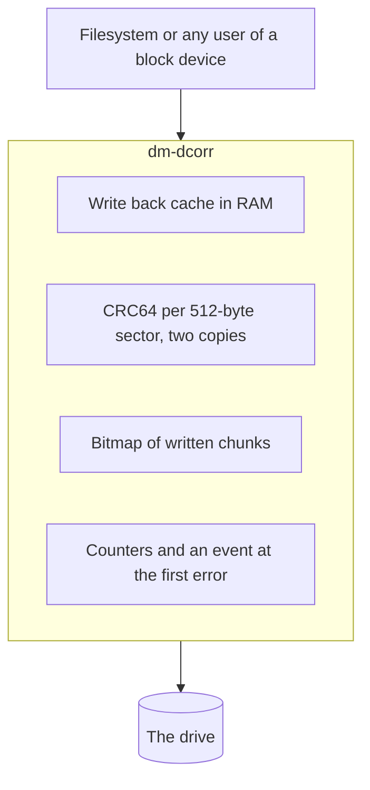
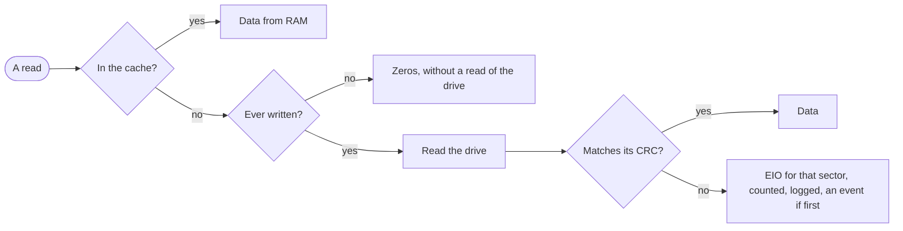

# dm-dcorr

[Русская версия](docs/ru/README.md)

**A Linux device mapper target that keeps the data of a failing drive readable long enough to move it.** It
checks every sector it reads against a CRC64 of its own, turns damaged data into a read error instead of wrong
data, and raises an alarm at the first sign of trouble. Correction of damaged data with an error correcting code is
the next big step: room for its parity is already in the on-disk format.

> **Status: in development.** Detection works and is tested in depth; correction and performance work are ahead,
> see [the stages](#status). Do not trust it with data you have no other copy of yet.

## Why

Drives rarely die at once. Sectors stop reading, bits rot silently, writes get lost at a power cut, and after the
first error a drive is 14 to 39 times more likely to fail within two months
([the reading behind it](docs/en/RESEARCH.md#drive-failures)). A filesystem trusts what the drive returns, so
silent damage spreads into backups. dm-dcorr sits between the filesystem and the drive and makes damage visible
the moment it is read.



## What it gives today

- **Silent damage is caught.** Every sector read is checked against its CRC; a sector that does not match fails
  with `EIO`, and only that sector. The CRC covers the salt of the device and the place of the sector, so data
  written to the wrong place, taken from another device or read back as zeros is caught too.
  [Threat model](docs/en/ARCHITECTURE.md#threat-model)
- **A crash leaves old or new data, never a false error.** The CRCs are kept in two copies, written in an order
  that survives a write cut short, so the driver never mistakes an interrupted write for damage.
  [Contract](docs/en/ARCHITECTURE.md#contract-with-the-layer-above)
- **Lost writes are caught.** A write the drive acknowledged and dropped fails its CRC once the next flush has
  passed. [Diagram](docs/en/DIAGRAMS.md#lost-writes)
- **A failing drive keeps working where it can.** A sector that does not read fails only the requests over it; a
  write that fails stays in RAM and is retried, and flushes fail until it is written.
  [Errors](docs/en/ARCHITECTURE.md#errors)
- **Every error is a signal.** `dmsetup status` counts failed reads, writes and flushes and damaged sectors, the
  first error raises a device mapper event for `dmsetup wait` or `dmeventd`, and the kernel log names the device
  and the sector. [Interface](docs/en/ARCHITECTURE.md#interface)
- **An ordinary block device.** Filesystems run on it unchanged: flushes and FUA writes are honoured, discard
  and write zeroes work in chunks of 4 KiB, and about 91% of the drive holds data, with groups of 1 GiB; the rest
  is metadata, about 3%, and room reserved for parity, 6.25%. [On-disk format](docs/en/ARCHITECTURE.md#on-disk-format)

What happens on a read:



More situations, each with the tests that cover it, are in [DIAGRAMS.md](docs/en/DIAGRAMS.md).

## Quick start

It is built and tested with Linux 7.1 and 7.2. You need the headers of your kernel, `make` and a C compiler.

```bash
make                                   # dm-dcorr.ko and tools/dcorrsetup
sudo modprobe dm-mod
sudo insmod dm-dcorr.ko
```

Format a device and put the driver on it. **Formatting overwrites the headers of the device**, so take one
whose data you do not need:

```bash
sudo tools/dcorrsetup format /dev/sdX
sudo tools/dcorrsetup table /dev/sdX | sudo dmsetup create dcorr
sudo mkfs.ext4 /dev/mapper/dcorr
```

`dcorrsetup format` refuses a device in use or one that already holds a valid superblock, unless given
`--force`; `--group-size` chooses the size of a group, `1G` by default. The device need not be zeroed: chunks
never written read as zeros. The lower device must have logical blocks of 512 bytes.

Watch it:

```bash
sudo dmsetup status dcorr              # 26 counters, see Interface
sudo dmsetup wait dcorr                # returns once an event is raised, as at the first error
sudo dmsetup remove dcorr
```

## Status

| Stage | What | State |
| --- | --- | --- |
| Test base | 368 tests in a VM: data, damage, crashes replayed from a log, failing drives, filesystems, load | Done; the commit before the cache is to be marked for the baseline |
| Cache | A write back cache of its own, flushes and FUA | Done |
| Integrity and format | Groups and superblocks, two copies of the CRCs, the bitmap of written chunks, discard | Done |
| Device mapper integration | Counters, the event, the table, queue limits, write zeroes; this documentation | Done |
| Runs | Neighbouring chunks written back as one request | Next |
| Baseline | Benchmarks on a non-debug kernel | Planned |
| Correction | An erasure code across chunks, rebuilding damaged data | Planned |
| Optimization | What was left simple for correctness first | Planned |

Performance has not been measured on this version yet; the numbers of the first version, which had no cache, are
in [its documentation](docs/ru/archive/full_docs.pdf), in Russian. The details of every stage are in
[TODO.md](docs/en/TODO.md#stages).

## Documentation

| Document | What is in it |
| --- | --- |
| [ARCHITECTURE.md](docs/en/ARCHITECTURE.md) | How it works: a glossary, the threat model, the contract, the format, the I/O path, the interface |
| [DIAGRAMS.md](docs/en/DIAGRAMS.md) | Its situations as pictures, with the tests that cover them |
| [DECISIONS.md](docs/en/DECISIONS.md) | Why it is built this way: each choice, the options, the reasons |
| [RESEARCH.md](docs/en/RESEARCH.md) | The reading behind it: how drives fail, how other targets do it |
| [TESTS.md](docs/en/TESTS.md) | What the tests check, and how they were shown to catch bugs |
| [DEPLOY.md](docs/en/DEPLOY.md) | The development VM, where the driver is built, loaded and tested |
| [TODO.md](docs/en/TODO.md) | What is not done yet, and the stages |
| [TODO_OPTIMIZATION.md](docs/en/TODO_OPTIMIZATION.md) | What was left simple, to be measured and improved |

## Development

The driver is built, loaded and tested only in a QEMU VM with a debug kernel (KASAN, lockdep, kmemleak), never on
the host of the developer: `deploy/vm.sh test` runs the tests there, `deploy/vm.sh check` the compiler warnings,
sparse and checkpatch. Crashes are replayed from a log of the writes, failing drives are made with `dm-dust` and
`dm-flakey`, and every new test is shown to fail on a deliberately broken driver. See
[DEPLOY.md](docs/en/DEPLOY.md) and [TESTS.md](docs/en/TESTS.md).

## License

GPL-2.0. Author: Alexey Smirnov. Developed as part of research into block-level data integrity for Linux storage.
