# Diagrams

The situations of [ARCHITECTURE.md](ARCHITECTURE.md) as pictures, each with the tests that cover it. The terms are
in the [glossary](ARCHITECTURE.md#glossary); the tests are described in [TESTS.md](TESTS.md), and live in
[`tests/`](../../tests). `tools/check-docs.py` checks that every diagram here parses. What the driver does wrong
today, each case a strict `xfail`, is drawn at the end, in [Cases that fail today](#cases-that-fail-today).

## The stack

Covered by the whole suite; end to end by [`test_data.py`](../../tests/test_data.py) (`test_roundtrip`,
`test_random_writes_match_a_reference_copy`), [`test_filesystem.py`](../../tests/test_filesystem.py) and
[`test_fio.py`](../../tests/test_fio.py).

## The layout

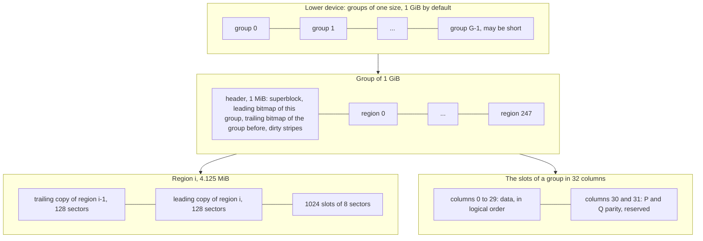

Covered by [`test_data.py`](../../tests/test_data.py): `test_capacity_excludes_metadata_and_parity`,
`test_layout_of_the_chunks_at_the_borders`, `test_data_lands_at_the_layout_position`,
`test_metadata_is_written_outside_the_data`; [`test_superblock.py`](../../tests/test_superblock.py):
`test_dcorrsetup_gives_the_layout_of_the_tests`, `test_every_region_lies_where_the_layout_says`,
`test_data_never_lands_in_the_parity_columns_nor_outside_the_regions`,
`test_the_header_of_every_group_holds_its_superblock_and_bitmaps`.

## Choosing the superblock

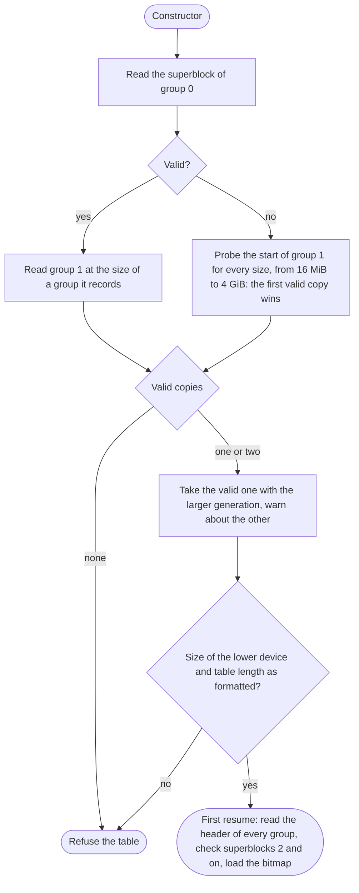

Covered by [`test_superblock.py`](../../tests/test_superblock.py): `test_a_device_without_a_superblock_is_refused`,
`test_one_damaged_copy_is_covered_by_the_other`, `test_both_damaged_copies_are_refused`,
`test_group_1_is_found_for_each_size_when_group_0_is_damaged`, `test_the_copy_with_the_larger_generation_is_taken`,
`test_a_device_of_another_size_is_refused`, `test_a_wrong_field_in_both_copies_is_refused`;
[`test_target.py`](../../tests/test_target.py): `test_a_length_other_than_the_capacity_is_rejected`;
[`test_bitmap.py`](../../tests/test_bitmap.py): `test_the_superblock_of_every_other_group_is_checked`.
The probe takes a copy stored as data as well: [The probe takes a copy stored as
data](#the-probe-takes-a-copy-stored-as-data).

## The write path

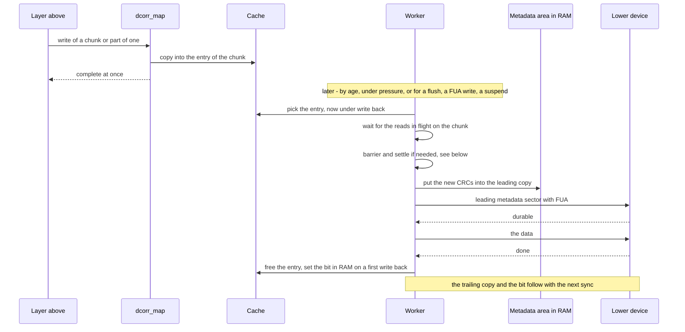

Covered by [`test_cache.py`](../../tests/test_cache.py): `test_a_write_reaches_the_lower_device_on_a_flush`,
`test_dirty_data_is_written_back_by_age`, `test_a_partial_chunk_writes_only_its_sectors`,
`test_writes_larger_than_the_cache_wait_for_free_entries`, `test_a_write_back_waits_for_a_read_in_flight`;
[`test_crash.py`](../../tests/test_crash.py): `test_the_leading_copy_is_durable_before_the_data`;
[`test_metadata.py`](../../tests/test_metadata.py): `test_a_write_back_reads_nothing_when_the_metadata_is_in_ram`;
[`test_bitmap.py`](../../tests/test_bitmap.py): `test_a_first_write_reads_back_with_zeros_around_it`.

## The read path

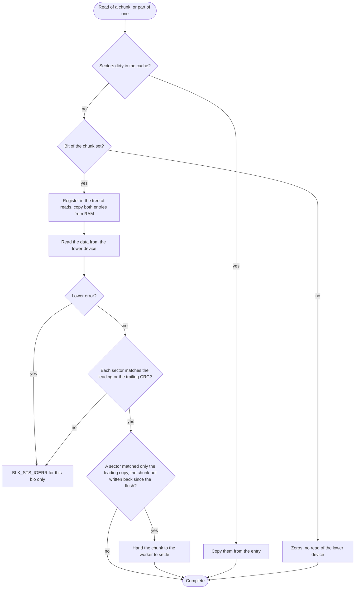

Covered by [`test_cache.py`](../../tests/test_cache.py): `test_a_read_of_a_partly_dirty_chunk`,
`test_a_dirty_sector_reads_while_a_clean_one_is_damaged`, `test_a_read_of_a_clean_sector_waits_for_the_write_back`;
[`test_bitmap.py`](../../tests/test_bitmap.py): `test_a_device_of_random_data_reads_zeros_once_formatted`;
[`test_corruption.py`](../../tests/test_corruption.py): `test_data_corruption_fails_only_that_sector`,
`test_crc_corruption_in_one_copy_is_covered_by_the_other`;
[`test_metadata.py`](../../tests/test_metadata.py): `test_a_read_takes_one_lower_read_when_the_metadata_is_in_ram`;
[`test_lower_errors.py`](../../tests/test_lower_errors.py): `test_failed_data_sector_fails_only_its_reads`;
[`test_lost_writes.py`](../../tests/test_lost_writes.py): `test_old_data_put_back_fails_once_the_new_was_read`;
[`test_crash.py`](../../tests/test_crash.py): `test_a_second_crash_after_one_between_the_copies`.

## An entry of the cache

Covered by [`test_cache.py`](../../tests/test_cache.py): `test_a_suspend_writes_back`,
`test_a_read_of_a_clean_sector_waits_for_the_write_back`;
[`test_lower_errors.py`](../../tests/test_lower_errors.py): `test_failed_write_is_reported`,
`test_writes_fail_while_reads_go_on`, `test_a_cache_full_of_failed_chunks_refuses_writes`;
[`test_discard.py`](../../tests/test_discard.py): `test_data_in_the_cache_is_dropped_by_a_discard`.

## The sync

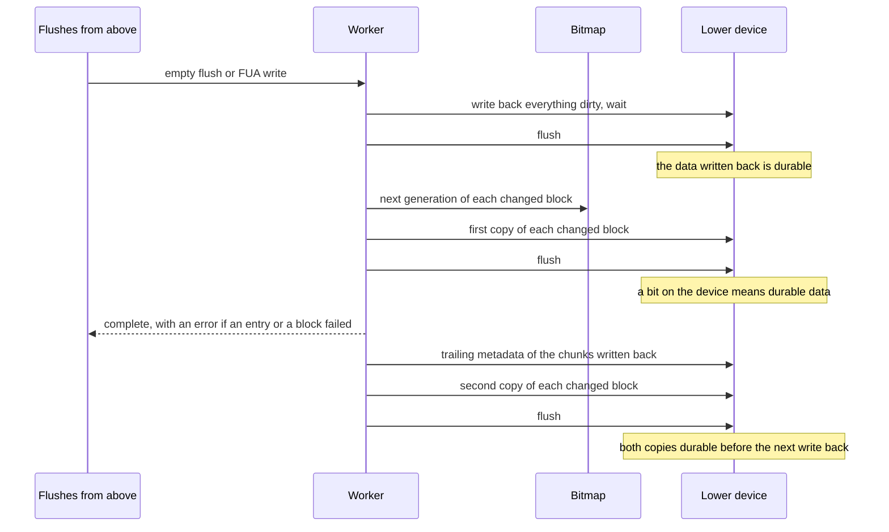

Covered by [`test_durability.py`](../../tests/test_durability.py) (all);
[`test_metadata.py`](../../tests/test_metadata.py): `test_the_trailing_copy_is_written_after_a_flush`;
[`test_bitmap.py`](../../tests/test_bitmap.py): `test_a_bit_reaches_the_device_only_with_a_flush`,
`test_a_flush_fails_when_the_first_copy_of_a_block_fails_to_write`, `test_a_second_copy_that_fails_to_write_is_counted`;
[`test_crash.py`](../../tests/test_crash.py): `test_flushed_writes_survive_a_crash`.

The same sync runs for a barrier, when half the metadata areas are busy, and on a suspend. If the first flush
fails, the flushes from above fail and no trailing copy is written; the chunks written back stay pinned for the
next sync: [A failed flush of the lower device](#a-failed-flush-of-the-lower-device).

## A failed flush of the lower device

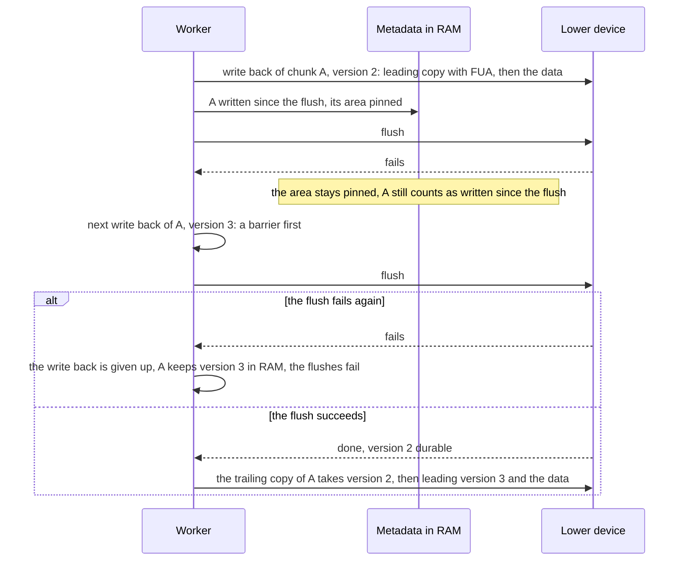

Covered by [`test_lower_errors.py`](../../tests/test_lower_errors.py):
`test_a_chunk_written_back_again_after_a_failed_flush_takes_a_barrier`, a barrier with a failed flush between the
two write backs as with none, and `test_a_chunk_whose_barrier_fails_is_not_written_back`.

## A crash between the two copies

What a sector holds after a crash at each point of a write back of new data over old, and what reads.

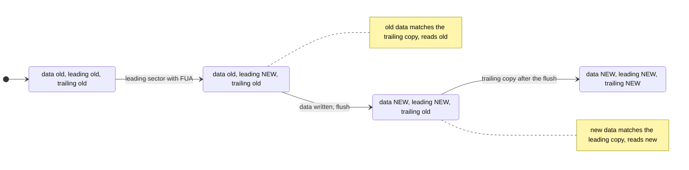

A crash in any state leaves each sector readable, as old or new. A crash in the middle states together with a
lost sector of the copy that matches fails the chunk while the sector does not read, by decision, and a write of a
neighbour does not make it permanent: [A metadata sector rebuilt from one copy](#a-metadata-sector-rebuilt-from-one-copy). A crash after the flush from
above and before the trailing copy leaves the state with the new data; the first read of it, which matches only
the leading copy, hands the chunk to the worker to settle, see [The read path](#the-read-path).

Covered by [`test_crash.py`](../../tests/test_crash.py): `test_a_write_cut_between_data_and_metadata_reads_old_or_new`,
`test_chunks_of_a_region_cut_between_flushes_read_old_or_new_each`, `test_ext4_survives_a_crash_after_each_fsync`,
`test_ext4_survives_a_crash_at_any_flush`.

## Before a write back: barrier and settle

Covered by [`test_crash.py`](../../tests/test_crash.py):
`test_a_chunk_written_back_twice_between_flushes_reads_one_of_its_versions`,
`test_a_second_crash_after_one_between_the_copies`, `test_first_writes_cut_anywhere_read_zeros_or_new`,
`test_a_write_after_a_discard_cut_anywhere_reads_zeros_or_new`;
[`test_corruption.py`](../../tests/test_corruption.py): `test_a_sector_whose_copies_differ_is_read_before_it_is_written`,
`test_only_the_sectors_written_are_read_first`, `test_a_sector_matching_neither_copy_is_counted_before_it_is_written`;
[`test_discard.py`](../../tests/test_discard.py): `test_a_write_after_a_discard_is_written_whole_after_a_barrier`,
`test_a_second_write_after_a_flushed_discard_needs_no_barrier`.

## The bitmap: choosing a copy of a block

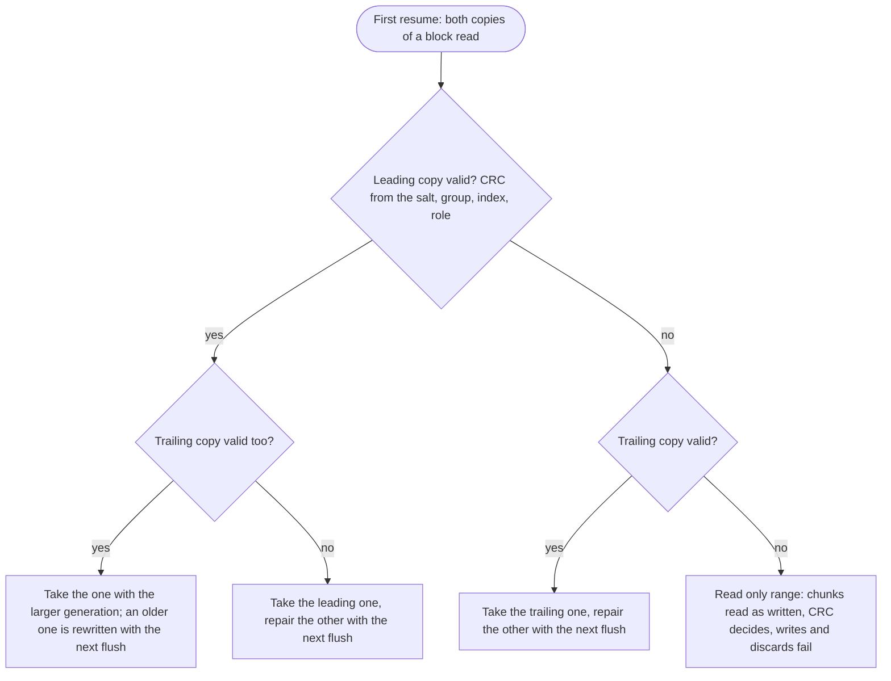

Covered by [`test_bitmap.py`](../../tests/test_bitmap.py): `test_one_damaged_copy_is_covered_and_repaired`,
`test_the_copy_with_the_larger_generation_is_taken`, `test_a_block_of_another_place_or_device_is_not_taken`,
`test_a_block_invalid_in_both_copies_makes_its_range_read_only`, `test_a_discard_touching_a_read_only_block_fails_whole`,
`test_a_reload_keeps_the_bits_the_old_table_sets`; [`test_lost_writes.py`](../../tests/test_lost_writes.py):
`test_a_lost_copy_of_a_block_of_the_bitmap_is_covered_by_the_other`, and for the older copy rewritten
`test_an_older_copy_is_rewritten_before_the_newer_is_lost`. What a read only range gives for a chunk zeroed
before: [A zeroed chunk in a read only range](#a-zeroed-chunk-in-a-read-only-range).

## Discard and its trap

Covered by [`test_discard.py`](../../tests/test_discard.py) (all); [`test_crash.py`](../../tests/test_crash.py):
`test_a_discard_cut_anywhere_reads_old_or_zeros`, `test_a_write_after_a_discard_cut_anywhere_reads_zeros_or_new`;
[`test_bitmap.py`](../../tests/test_bitmap.py): `test_a_discard_touching_a_read_only_block_fails_whole`.

## Write zeroes

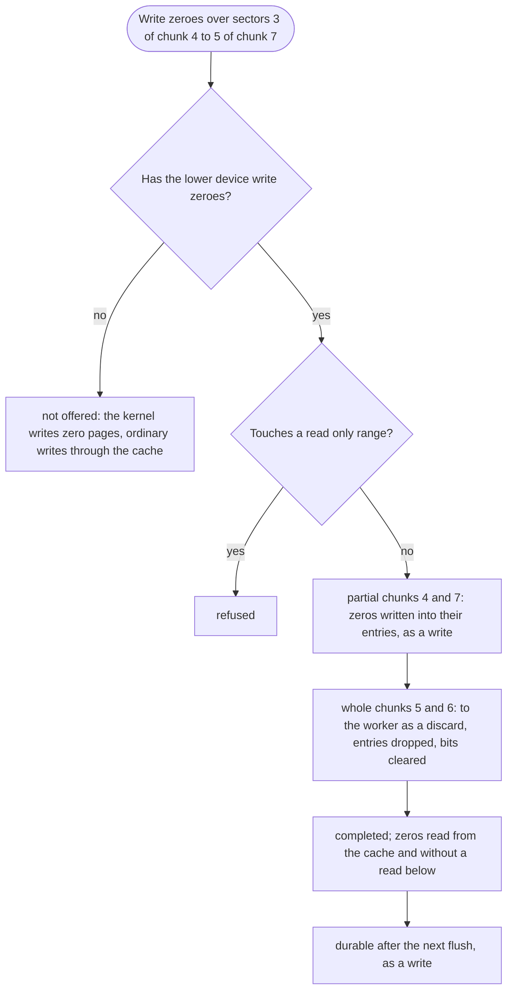

Covered by [`test_discard.py`](../../tests/test_discard.py): `test_the_device_offers_discard_in_chunks_and_write_zeroes`,
`test_write_zeroes_reads_zeros_and_keeps_the_neighbours`, `test_write_zeroes_survives_recreating_the_device`,
`test_write_zeroes_over_data_in_the_cache`, `test_blkdiscard_z_zeroes_through_write_zeroes`,
`test_write_zeroes_inside_one_chunk_zeroes_only_its_sectors`; [`test_lower_errors.py`](../../tests/test_lower_errors.py):
`test_write_zeroes_is_not_offered_over_a_lower_device_without_it`.

## Failures of the lower device

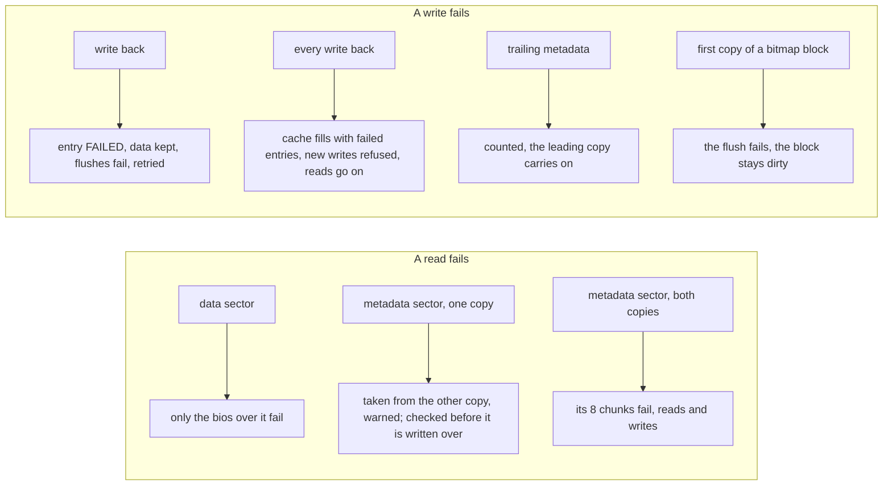

Covered by [`test_lower_errors.py`](../../tests/test_lower_errors.py) (all);
[`test_bitmap.py`](../../tests/test_bitmap.py): `test_a_flush_fails_when_the_first_copy_of_a_block_fails_to_write`,
`test_a_second_copy_that_fails_to_write_is_counted`. A metadata sector failed in one copy after a crash: [A
metadata sector rebuilt from one copy](#a-metadata-sector-rebuilt-from-one-copy); a failed flush: [A failed
flush of the lower device](#a-failed-flush-of-the-lower-device).

## A metadata sector rebuilt from one copy

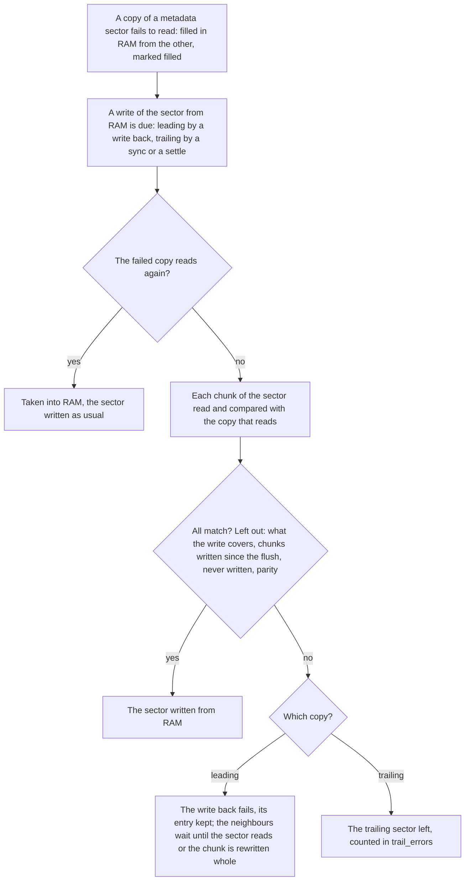

After a crash in a write back the copies of a chunk differ and its data matches only one of them; if that copy
fails to read, writing the sector from RAM would put the other CRC on the device and fail the chunk for good.
Covered by [`test_lower_errors.py`](../../tests/test_lower_errors.py):
`test_a_sector_rebuilt_from_one_copy_keeps_its_neighbours_readable`, with the leading copy failed after a crash
after the data, the write back of a neighbour failing until the sector heals; with the trailing copy failed after
a crash before the data, the neighbour written and the trailing sector left; with the copies equal, and with the
failed copy reading again, the neighbour written.

## Every error is a signal

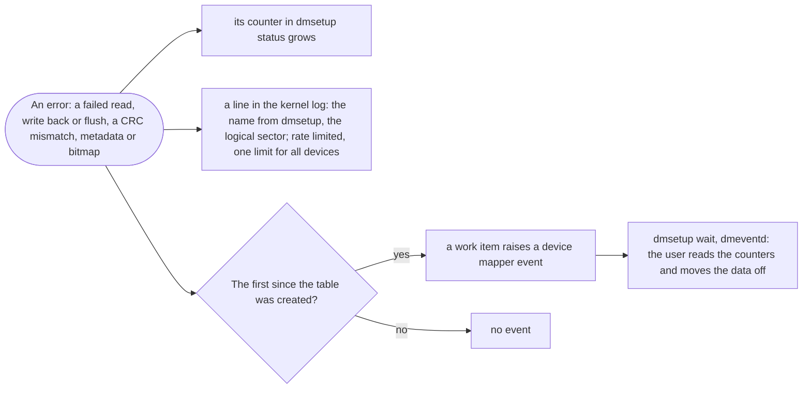

Covered by [`test_lower_errors.py`](../../tests/test_lower_errors.py):
`test_the_first_error_raises_one_device_mapper_event`, `test_a_failed_read_is_counted_and_logged_with_the_device`,
`test_a_failed_metadata_read_is_counted_in_sectors`, `test_a_failed_flush_is_counted`,
`test_failed_write_is_reported`; [`test_corruption.py`](../../tests/test_corruption.py):
`test_every_damaged_sector_of_a_read_is_counted_and_logged`,
`test_a_flood_of_mismatches_is_counted_whole_and_logged_rate_limited`. The limit of each place in the code is
shared by all devices, so a flood on one hides the first errors of another for 5 s: strict `xfail`
`test_a_flood_on_one_device_does_not_hide_the_errors_of_another`.

## Lost writes

A write acknowledged by the lower device and never on its medium.

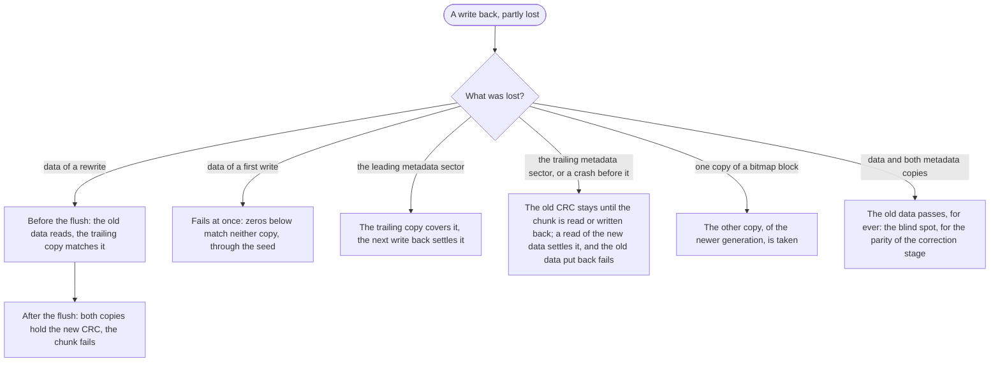

Covered by [`test_lost_writes.py`](../../tests/test_lost_writes.py) (all); the seed by
[`test_corruption.py`](../../tests/test_corruption.py): `test_zeroed_chunk_is_detected`,
`test_chunk_copied_elsewhere_is_detected`, `test_sectors_swapped_inside_a_chunk_with_their_crcs_are_detected`,
`test_a_zeroed_region_with_its_chunks_written_is_detected`, `test_a_region_shifted_whole_with_its_metadata_is_detected`,
`test_a_chunk_from_another_device_is_detected`.

## Cases that fail today

Found by the review of `src/` on 2026-11-17, each pinned by a strict `xfail` with its item in [TODO.md](TODO.md);
the diagram shows the path to the wrong result. A positive control of each test passes.

### A zeroed chunk in a read only range

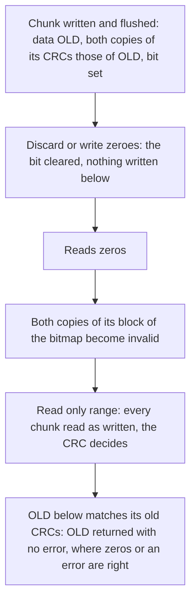

Pinned by `test_a_zeroed_chunk_in_a_read_only_block_never_reads_its_old_data`, for discard and write zeroes.

### The probe takes a copy stored as data

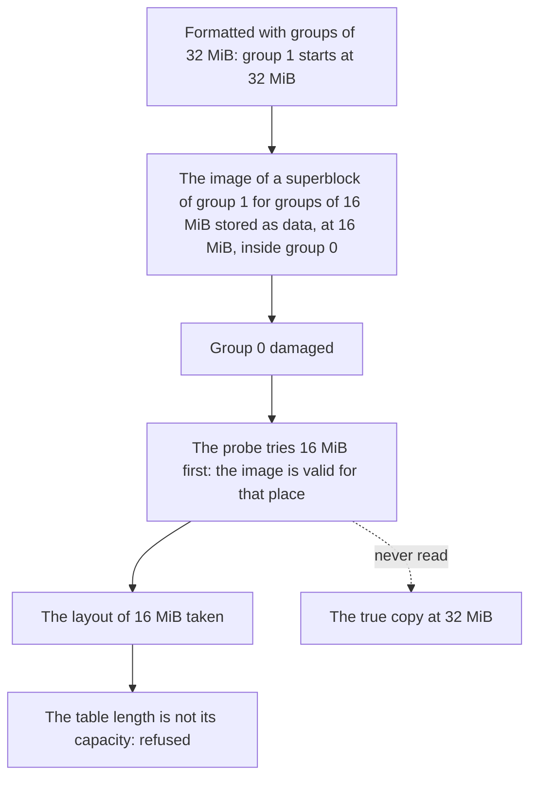

Pinned by `test_a_superblock_stored_as_data_does_not_win_the_probe`. With a table for the layout of the image the
device would come up over the wrong layout.

### Two devices on one lower device

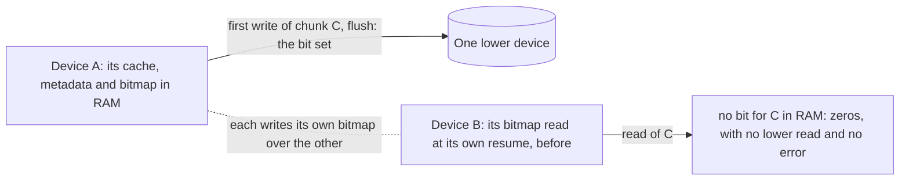

Pinned by `test_a_second_device_on_the_same_lower_device_is_refused_or_agrees`: device mapper takes the second
table, so the second device reads zeros where the first wrote.
