# Diagrams

The situations of [ARCHITECTURE.md](ARCHITECTURE.md) as pictures, each with the tests that cover it. The terms are
in the [glossary](ARCHITECTURE.md#glossary); the tests are described in [TESTS.md](TESTS.md), and live in
[`tests/`](../../tests). `tools/check-docs.py` checks that every diagram here parses.

## The stack

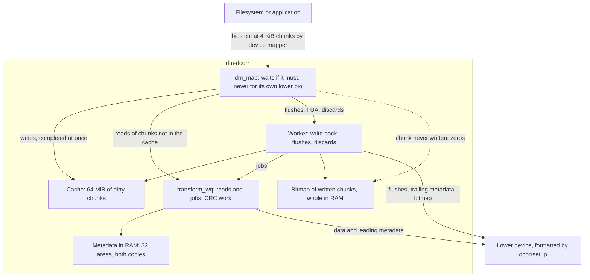

Covered by the whole suite; end to end by [`test_data.py`](../../tests/test_data.py) (`test_roundtrip`,
`test_random_writes_match_a_reference_copy`), [`test_filesystem.py`](../../tests/test_filesystem.py) and
[`test_fio.py`](../../tests/test_fio.py).

## The layout

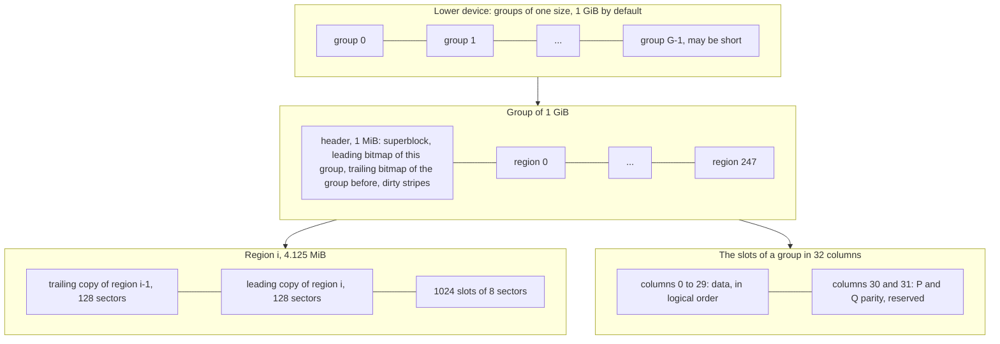

Covered by [`test_data.py`](../../tests/test_data.py): `test_capacity_excludes_metadata_and_parity`,
`test_layout_of_the_chunks_at_the_borders`, `test_data_lands_at_the_layout_position`,
`test_metadata_is_written_outside_the_data`; [`test_superblock.py`](../../tests/test_superblock.py):
`test_dcorrsetup_gives_the_layout_of_the_tests`, `test_every_region_lies_where_the_layout_says`,
`test_data_never_lands_in_the_parity_columns_nor_outside_the_regions`,
`test_the_header_of_every_group_holds_its_superblock_and_bitmaps`.

## Choosing the superblock

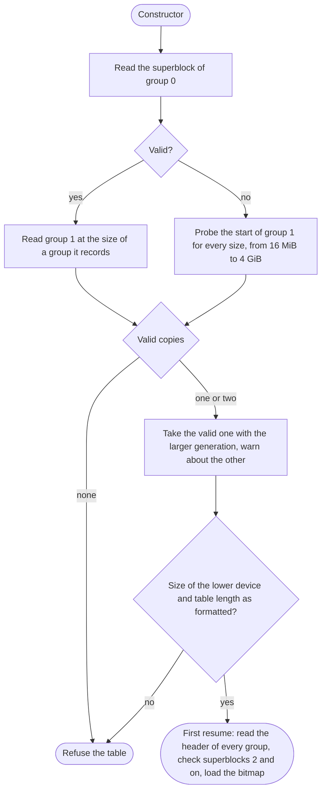

Covered by [`test_superblock.py`](../../tests/test_superblock.py): `test_a_device_without_a_superblock_is_refused`,
`test_one_damaged_copy_is_covered_by_the_other`, `test_both_damaged_copies_are_refused`,
`test_group_1_is_found_for_each_size_when_group_0_is_damaged`, `test_the_copy_with_the_larger_generation_is_taken`,
`test_a_device_of_another_size_is_refused`, `test_a_wrong_field_in_both_copies_is_refused`;
[`test_target.py`](../../tests/test_target.py): `test_a_length_other_than_the_capacity_is_rejected`;
[`test_bitmap.py`](../../tests/test_bitmap.py): `test_the_superblock_of_every_other_group_is_checked`.

## The write path

Covered by [`test_cache.py`](../../tests/test_cache.py): `test_a_write_reaches_the_lower_device_on_a_flush`,
`test_dirty_data_is_written_back_by_age`, `test_a_partial_chunk_writes_only_its_sectors`,
`test_writes_larger_than_the_cache_wait_for_free_entries`, `test_a_write_back_waits_for_a_read_in_flight`;
[`test_crash.py`](../../tests/test_crash.py): `test_the_leading_copy_is_durable_before_the_data`;
[`test_metadata.py`](../../tests/test_metadata.py): `test_a_write_back_reads_nothing_when_the_metadata_is_in_ram`;
[`test_bitmap.py`](../../tests/test_bitmap.py): `test_a_first_write_reads_back_with_zeros_around_it`.

## The read path

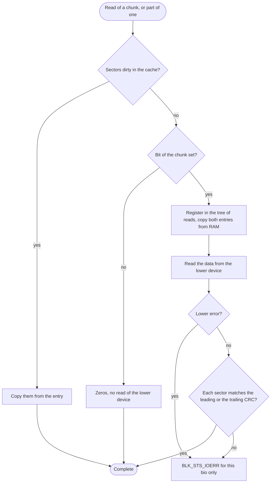

Covered by [`test_cache.py`](../../tests/test_cache.py): `test_a_read_of_a_partly_dirty_chunk`,
`test_a_dirty_sector_reads_while_a_clean_one_is_damaged`, `test_a_read_of_a_clean_sector_waits_for_the_write_back`;
[`test_bitmap.py`](../../tests/test_bitmap.py): `test_a_device_of_random_data_reads_zeros_once_formatted`;
[`test_corruption.py`](../../tests/test_corruption.py): `test_data_corruption_fails_only_that_sector`,
`test_crc_corruption_in_one_copy_is_covered_by_the_other`;
[`test_metadata.py`](../../tests/test_metadata.py): `test_a_read_takes_one_lower_read_when_the_metadata_is_in_ram`;
[`test_lower_errors.py`](../../tests/test_lower_errors.py): `test_failed_data_sector_fails_only_its_reads`.

## An entry of the cache

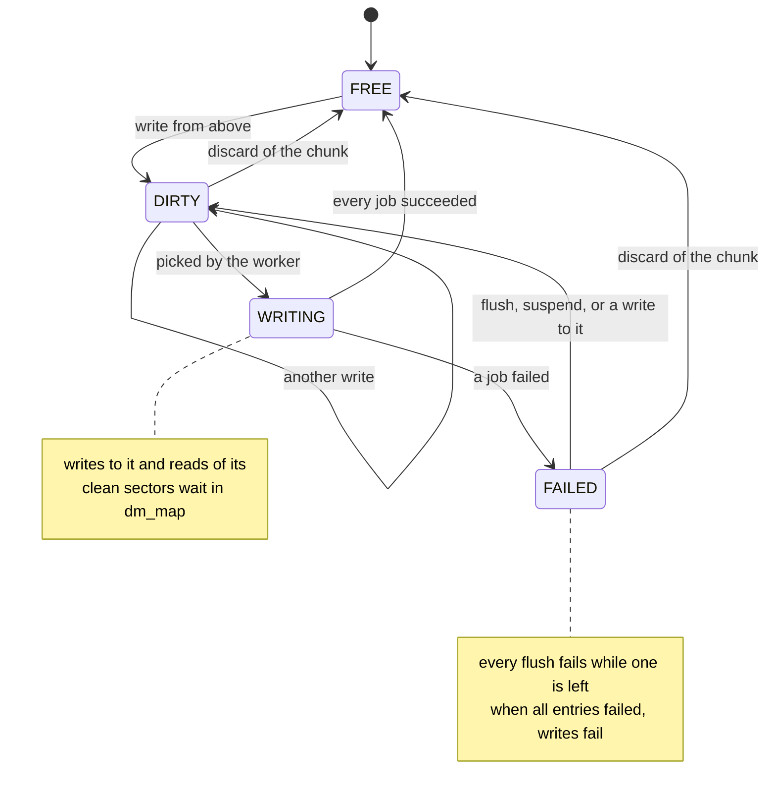

Covered by [`test_cache.py`](../../tests/test_cache.py): `test_a_suspend_writes_back`,
`test_a_read_of_a_clean_sector_waits_for_the_write_back`;
[`test_lower_errors.py`](../../tests/test_lower_errors.py): `test_failed_write_is_reported`,
`test_writes_fail_while_reads_go_on`, `test_a_cache_full_of_failed_chunks_refuses_writes`;
[`test_discard.py`](../../tests/test_discard.py): `test_data_in_the_cache_is_dropped_by_a_discard`.

## The sync

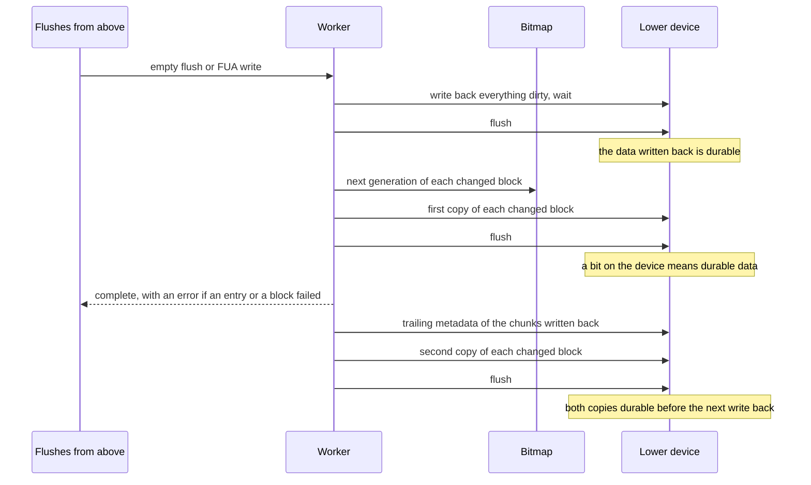

Covered by [`test_durability.py`](../../tests/test_durability.py) (all);
[`test_metadata.py`](../../tests/test_metadata.py): `test_the_trailing_copy_is_written_after_a_flush`;
[`test_bitmap.py`](../../tests/test_bitmap.py): `test_a_bit_reaches_the_device_only_with_a_flush`,
`test_a_flush_fails_when_the_first_copy_of_a_block_fails_to_write`, `test_a_second_copy_that_fails_to_write_is_counted`;
[`test_crash.py`](../../tests/test_crash.py): `test_flushed_writes_survive_a_crash`.

## A crash between the two copies

What a sector holds after a crash at each point of a write back of new data over old, and what reads.

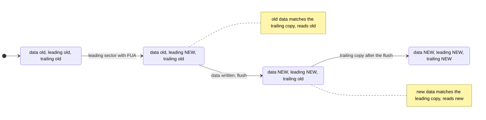

A crash in any state leaves each sector readable, as old or new. Not covered: a crash in the middle states
together with a lost sector of the copy that matches.

Covered by [`test_crash.py`](../../tests/test_crash.py): `test_a_write_cut_between_data_and_metadata_reads_old_or_new`,
`test_chunks_of_a_region_cut_between_flushes_read_old_or_new_each`, `test_ext4_survives_a_crash_after_each_fsync`,
`test_ext4_survives_a_crash_at_any_flush`.

## Before a write back: barrier and settle

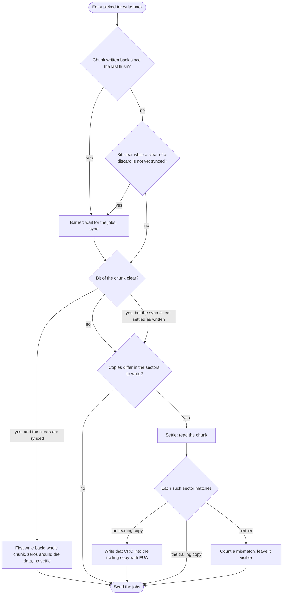

Covered by [`test_crash.py`](../../tests/test_crash.py):
`test_a_chunk_written_back_twice_between_flushes_reads_one_of_its_versions`,
`test_a_second_crash_after_one_between_the_copies`, `test_first_writes_cut_anywhere_read_zeros_or_new`,
`test_a_write_after_a_discard_cut_anywhere_reads_zeros_or_new`;
[`test_corruption.py`](../../tests/test_corruption.py): `test_a_sector_whose_copies_differ_is_read_before_it_is_written`,
`test_only_the_sectors_written_are_read_first`, `test_a_sector_matching_neither_copy_is_counted_before_it_is_written`;
[`test_discard.py`](../../tests/test_discard.py): `test_a_write_after_a_discard_is_written_whole_after_a_barrier`,
`test_a_second_write_after_a_flushed_discard_needs_no_barrier`.

## The bitmap: choosing a copy of a block

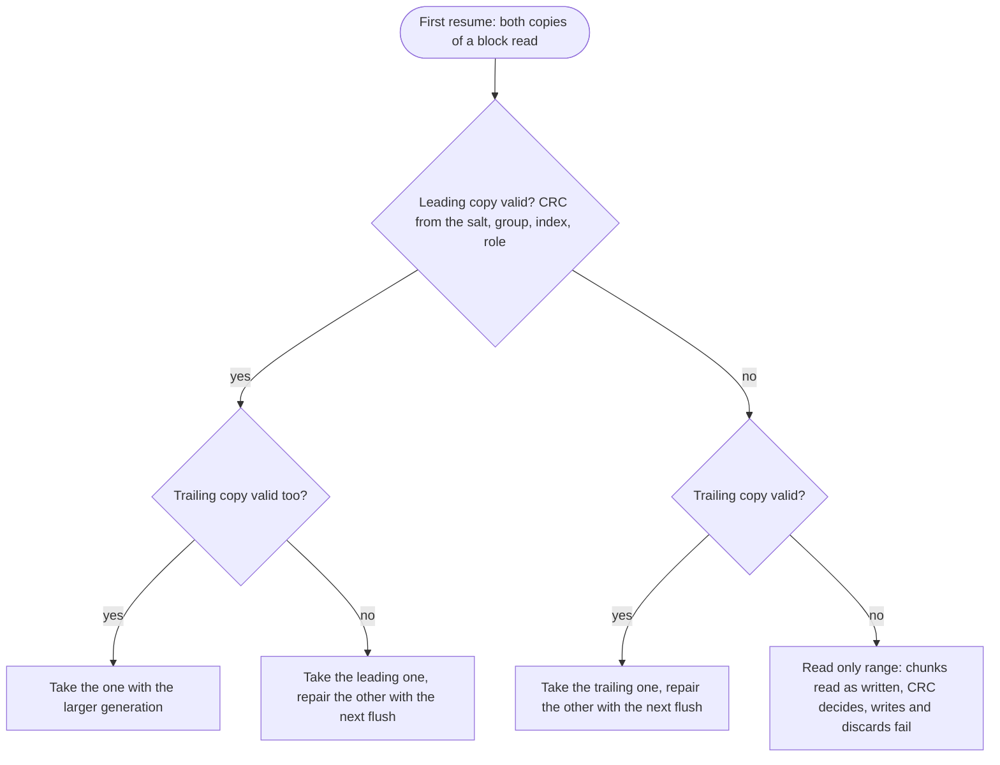

Covered by [`test_bitmap.py`](../../tests/test_bitmap.py): `test_one_damaged_copy_is_covered_and_repaired`,
`test_the_copy_with_the_larger_generation_is_taken`, `test_a_block_of_another_place_or_device_is_not_taken`,
`test_a_block_invalid_in_both_copies_makes_its_range_read_only`, `test_a_discard_touching_a_read_only_block_fails_whole`,
`test_a_reload_keeps_the_bits_the_old_table_sets`; [`test_lost_writes.py`](../../tests/test_lost_writes.py):
`test_a_lost_copy_of_a_block_of_the_bitmap_is_covered_by_the_other`.

## Discard and its trap

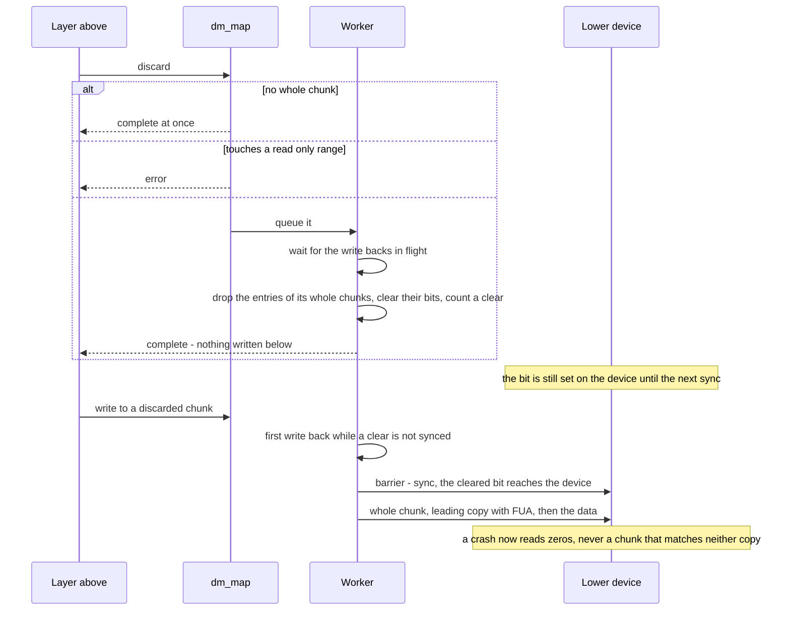

Covered by [`test_discard.py`](../../tests/test_discard.py) (all); [`test_crash.py`](../../tests/test_crash.py):
`test_a_discard_cut_anywhere_reads_old_or_zeros`, `test_a_write_after_a_discard_cut_anywhere_reads_zeros_or_new`;
[`test_bitmap.py`](../../tests/test_bitmap.py): `test_a_discard_touching_a_read_only_block_fails_whole`.

## Failures of the lower device

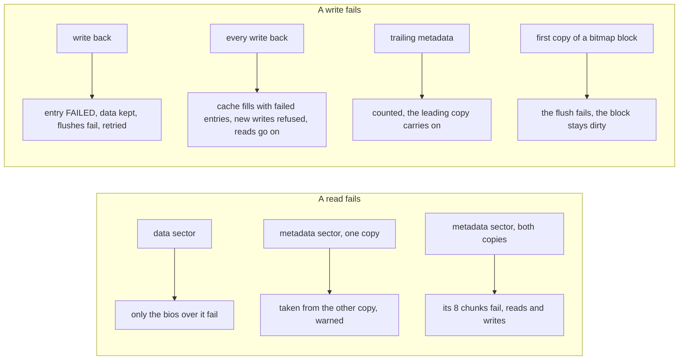

Covered by [`test_lower_errors.py`](../../tests/test_lower_errors.py) (all);
[`test_bitmap.py`](../../tests/test_bitmap.py): `test_a_flush_fails_when_the_first_copy_of_a_block_fails_to_write`,
`test_a_second_copy_that_fails_to_write_is_counted`.

## Lost writes

A write acknowledged by the lower device and never on its medium.

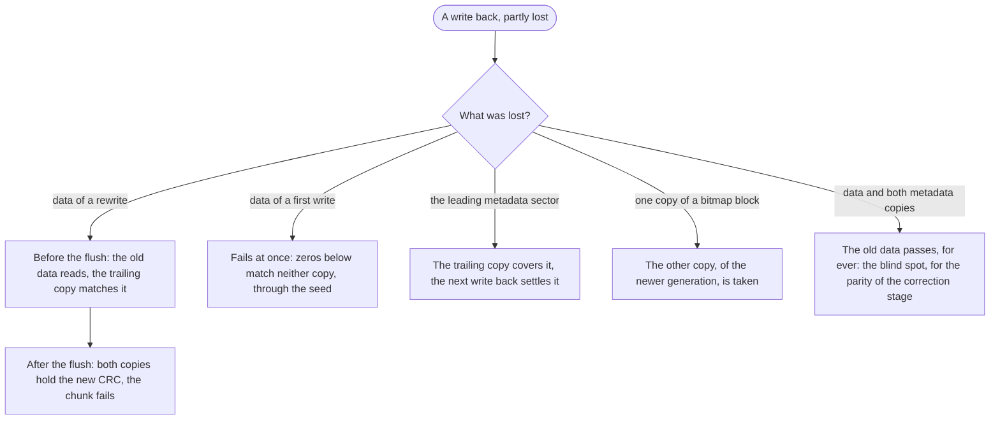

Covered by [`test_lost_writes.py`](../../tests/test_lost_writes.py) (all); the seed by
[`test_corruption.py`](../../tests/test_corruption.py): `test_zeroed_chunk_is_detected`,
`test_chunk_copied_elsewhere_is_detected`, `test_sectors_swapped_inside_a_chunk_with_their_crcs_are_detected`,
`test_a_zeroed_region_with_its_chunks_written_is_detected`, `test_a_region_shifted_whole_with_its_metadata_is_detected`,
`test_a_chunk_from_another_device_is_detected`.
