# Диаграммы

Ситуации из [ARCHITECTURE.md](ARCHITECTURE.md) в картинках, каждая с тестами, которые её покрывают. Термины — в
[глоссарии](ARCHITECTURE.md#глоссарий); тесты описаны в [TESTS.md](TESTS.md) и лежат в [`tests/`](../../tests).
`tools/check-docs.py` проверяет, что каждая диаграмма здесь разбирается. То, что драйвер сегодня делает неверно, каждый
случай — строгий `xfail`, нарисовано в конце, в разделе [Случаи, которые сейчас не
проходят](#случаи-которые-сейчас-не-проходят).

## Стек

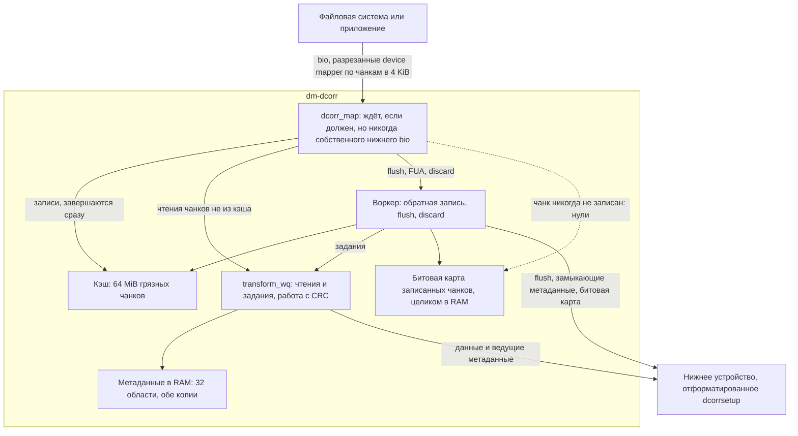

Покрыто всем набором; от начала до конца — [`test_data.py`](../../tests/test_data.py) (`test_roundtrip`,
`test_random_writes_match_a_reference_copy`), [`test_filesystem.py`](../../tests/test_filesystem.py) и
[`test_fio.py`](../../tests/test_fio.py).

## Формат

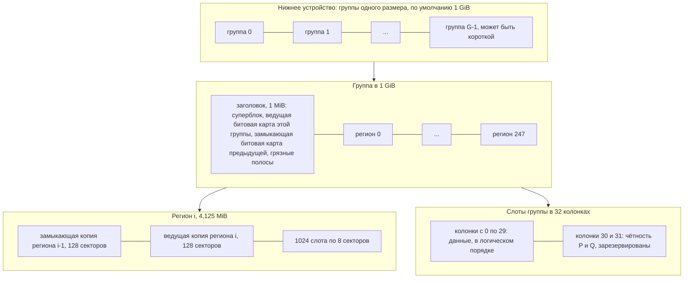

Покрыто [`test_data.py`](../../tests/test_data.py): `test_capacity_excludes_metadata_and_parity`,
`test_layout_of_the_chunks_at_the_borders`, `test_data_lands_at_the_layout_position`,
`test_metadata_is_written_outside_the_data`; [`test_superblock.py`](../../tests/test_superblock.py):
`test_dcorrsetup_gives_the_layout_of_the_tests`, `test_every_region_lies_where_the_layout_says`,
`test_data_never_lands_in_the_parity_columns_nor_outside_the_regions`,
`test_the_header_of_every_group_holds_its_superblock_and_bitmaps`.

## Выбор суперблока

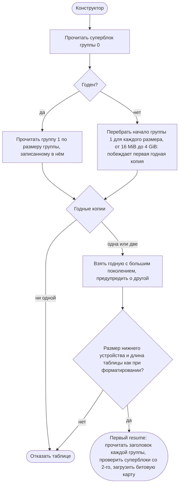

Покрыто [`test_superblock.py`](../../tests/test_superblock.py): `test_a_device_without_a_superblock_is_refused`,
`test_one_damaged_copy_is_covered_by_the_other`, `test_both_damaged_copies_are_refused`,
`test_group_1_is_found_for_each_size_when_group_0_is_damaged`, `test_the_copy_with_the_larger_generation_is_taken`,
`test_a_device_of_another_size_is_refused`, `test_a_wrong_field_in_both_copies_is_refused`;
[`test_target.py`](../../tests/test_target.py): `test_a_length_other_than_the_capacity_is_rejected`;
[`test_bitmap.py`](../../tests/test_bitmap.py): `test_the_superblock_of_every_other_group_is_checked`.
Поиск берёт и копию, сохранённую как данные: [Поиск берёт копию, сохранённую как
данные](#поиск-берёт-копию-сохранённую-как-данные).

## Путь записи

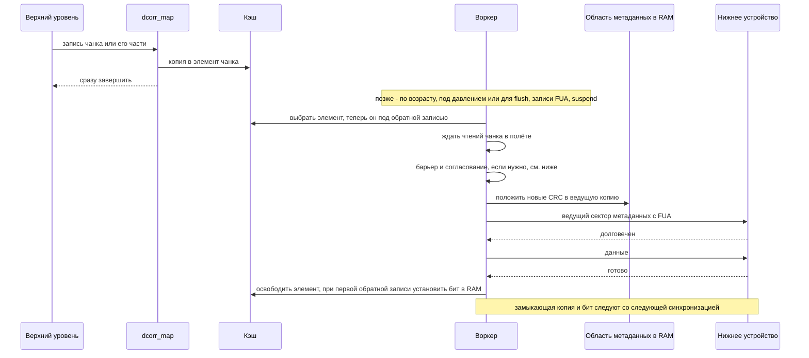

Покрыто [`test_cache.py`](../../tests/test_cache.py): `test_a_write_reaches_the_lower_device_on_a_flush`,
`test_dirty_data_is_written_back_by_age`, `test_a_partial_chunk_writes_only_its_sectors`,
`test_writes_larger_than_the_cache_wait_for_free_entries`, `test_a_write_back_waits_for_a_read_in_flight`;
[`test_crash.py`](../../tests/test_crash.py): `test_the_leading_copy_is_durable_before_the_data`;
[`test_metadata.py`](../../tests/test_metadata.py): `test_a_write_back_reads_nothing_when_the_metadata_is_in_ram`;
[`test_bitmap.py`](../../tests/test_bitmap.py): `test_a_first_write_reads_back_with_zeros_around_it`.

## Путь чтения

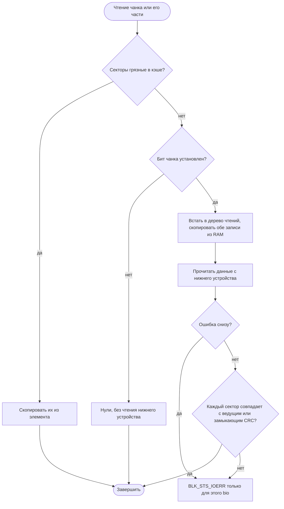

Покрыто [`test_cache.py`](../../tests/test_cache.py): `test_a_read_of_a_partly_dirty_chunk`,
`test_a_dirty_sector_reads_while_a_clean_one_is_damaged`, `test_a_read_of_a_clean_sector_waits_for_the_write_back`;
[`test_bitmap.py`](../../tests/test_bitmap.py): `test_a_device_of_random_data_reads_zeros_once_formatted`;
[`test_corruption.py`](../../tests/test_corruption.py): `test_data_corruption_fails_only_that_sector`,
`test_crc_corruption_in_one_copy_is_covered_by_the_other`;
[`test_metadata.py`](../../tests/test_metadata.py): `test_a_read_takes_one_lower_read_when_the_metadata_is_in_ram`;
[`test_lower_errors.py`](../../tests/test_lower_errors.py): `test_failed_data_sector_fails_only_its_reads`.

## Элемент кэша

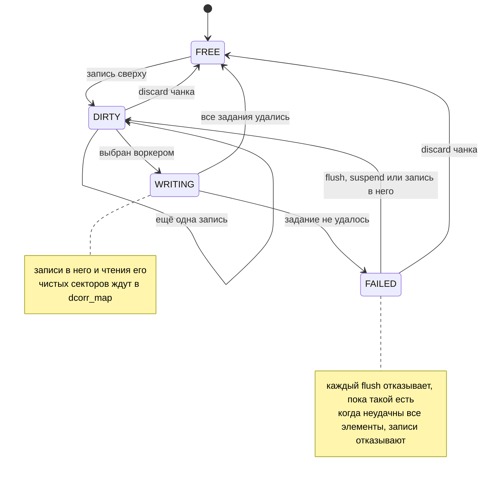

Покрыто [`test_cache.py`](../../tests/test_cache.py): `test_a_suspend_writes_back`,
`test_a_read_of_a_clean_sector_waits_for_the_write_back`;
[`test_lower_errors.py`](../../tests/test_lower_errors.py): `test_failed_write_is_reported`,
`test_writes_fail_while_reads_go_on`, `test_a_cache_full_of_failed_chunks_refuses_writes`;
[`test_discard.py`](../../tests/test_discard.py): `test_data_in_the_cache_is_dropped_by_a_discard`.

## Синхронизация

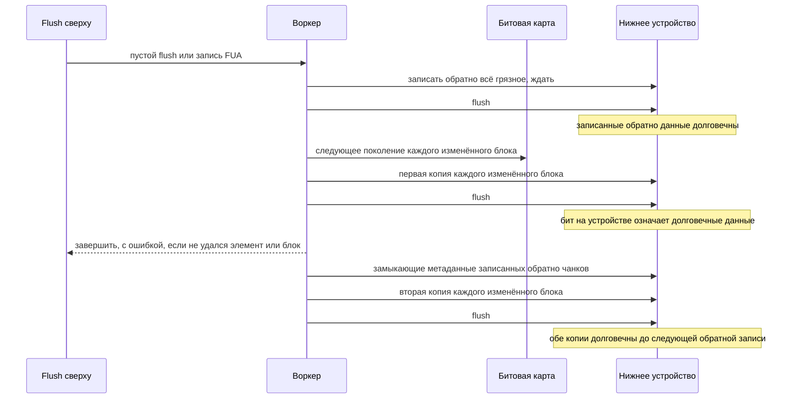

Покрыто [`test_durability.py`](../../tests/test_durability.py) (целиком);
[`test_metadata.py`](../../tests/test_metadata.py): `test_the_trailing_copy_is_written_after_a_flush`;
[`test_bitmap.py`](../../tests/test_bitmap.py): `test_a_bit_reaches_the_device_only_with_a_flush`,
`test_a_flush_fails_when_the_first_copy_of_a_block_fails_to_write`, `test_a_second_copy_that_fails_to_write_is_counted`;
[`test_crash.py`](../../tests/test_crash.py): `test_flushed_writes_survive_a_crash`.

Та же синхронизация выполняется для барьера, когда занята половина областей метаданных, и при suspend. Если первый
flush не удался, flush сверху отказывают и замыкающая копия не пишется; чанки, записанные обратно, остаются
закреплёнными до следующей синхронизации: [Неудавшийся flush нижнего устройства](#неудавшийся-flush-нижнего-устройства).

## Неудавшийся flush нижнего устройства

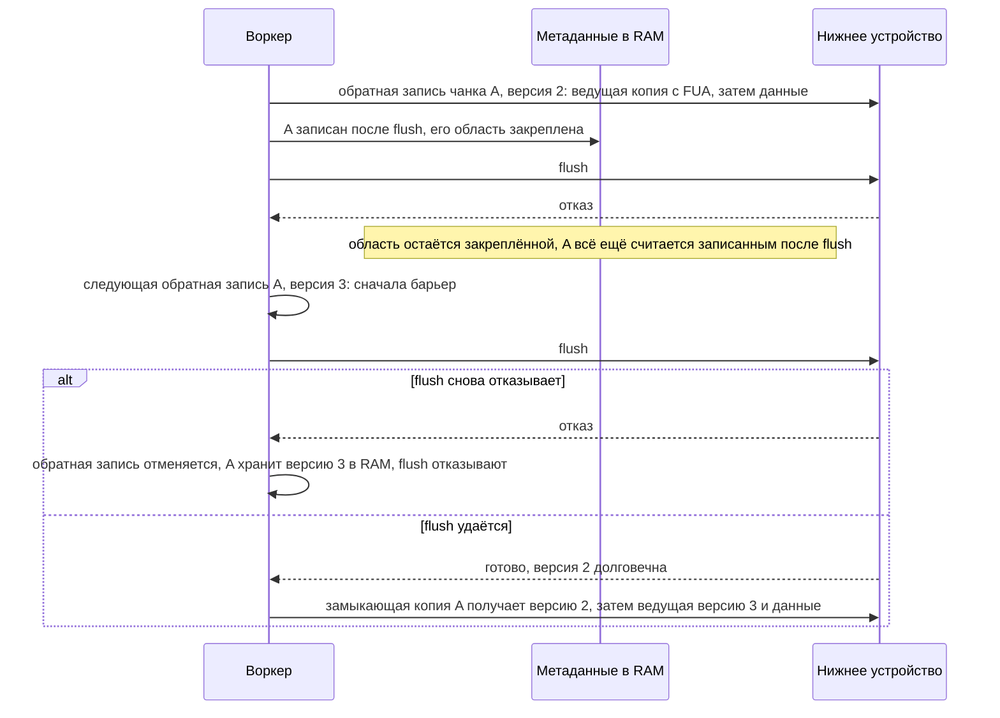

Покрыто [`test_lower_errors.py`](../../tests/test_lower_errors.py):
`test_a_chunk_written_back_again_after_a_failed_flush_takes_a_barrier`, барьер с неудавшимся flush между двумя
обратными записями, как и без него, и `test_a_chunk_whose_barrier_fails_is_not_written_back`.

## Крах между двумя копиями

Что хранит сектор после краха в каждой точке обратной записи новых данных поверх старых и что читается.

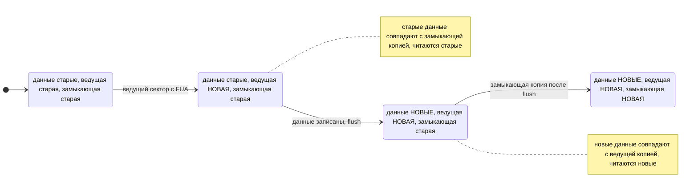

Крах в любом состоянии оставляет каждый сектор читаемым, старым или новым. Не покрыто: крах в средних состояниях
вместе с потерянным сектором той копии, которая совпадает, что последующая запись соседа делает постоянным, см.
[Сектор метаданных, восстановленный из одной копии](#сектор-метаданных-восстановленный-из-одной-копии). Крах после
flush сверху и до замыкающей копии оставляет состояние с новыми данными, и ничто не продвигает его дальше до
следующей обратной записи: [Замыкающая копия после перезапуска](#замыкающая-копия-после-перезапуска).

Покрыто [`test_crash.py`](../../tests/test_crash.py): `test_a_write_cut_between_data_and_metadata_reads_old_or_new`,
`test_chunks_of_a_region_cut_between_flushes_read_old_or_new_each`, `test_ext4_survives_a_crash_after_each_fsync`,
`test_ext4_survives_a_crash_at_any_flush`.

## Перед обратной записью: барьер и согласование

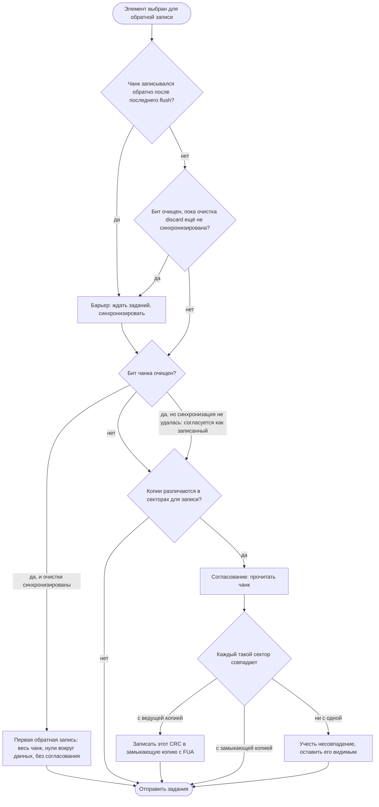

Покрыто [`test_crash.py`](../../tests/test_crash.py):
`test_a_chunk_written_back_twice_between_flushes_reads_one_of_its_versions`,
`test_a_second_crash_after_one_between_the_copies`, `test_first_writes_cut_anywhere_read_zeros_or_new`,
`test_a_write_after_a_discard_cut_anywhere_reads_zeros_or_new`;
[`test_corruption.py`](../../tests/test_corruption.py): `test_a_sector_whose_copies_differ_is_read_before_it_is_written`,
`test_only_the_sectors_written_are_read_first`, `test_a_sector_matching_neither_copy_is_counted_before_it_is_written`;
[`test_discard.py`](../../tests/test_discard.py): `test_a_write_after_a_discard_is_written_whole_after_a_barrier`,
`test_a_second_write_after_a_flushed_discard_needs_no_barrier`.

## Битовая карта: выбор копии блока

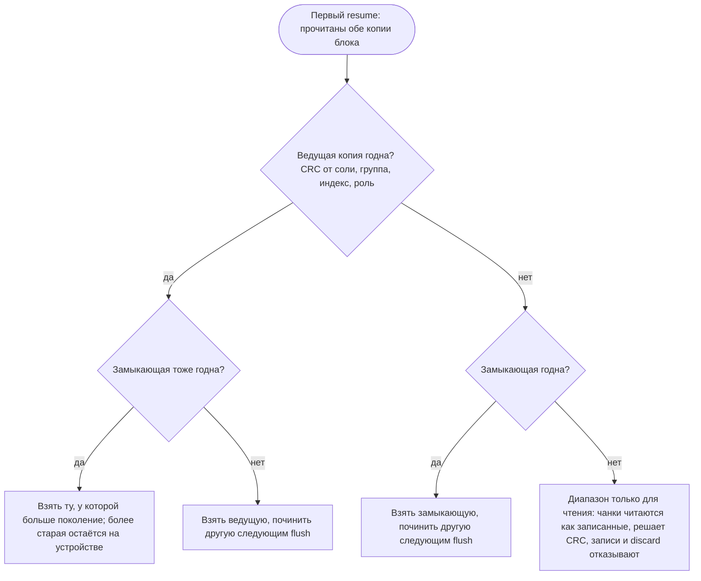

Покрыто [`test_bitmap.py`](../../tests/test_bitmap.py): `test_one_damaged_copy_is_covered_and_repaired`,
`test_the_copy_with_the_larger_generation_is_taken`, `test_a_block_of_another_place_or_device_is_not_taken`,
`test_a_block_invalid_in_both_copies_makes_its_range_read_only`, `test_a_discard_touching_a_read_only_block_fails_whole`,
`test_a_reload_keeps_the_bits_the_old_table_sets`; [`test_lost_writes.py`](../../tests/test_lost_writes.py):
`test_a_lost_copy_of_a_block_of_the_bitmap_is_covered_by_the_other`. Чего более старая копия стоит позже: [Более
старая копия блока битовой карты](#более-старая-копия-блока-битовой-карты); что диапазон только для чтения даёт
для чанка, обнулённого раньше: [Обнулённый чанк в диапазоне только для
чтения](#обнулённый-чанк-в-диапазоне-только-для-чтения).

## Discard и его ловушка

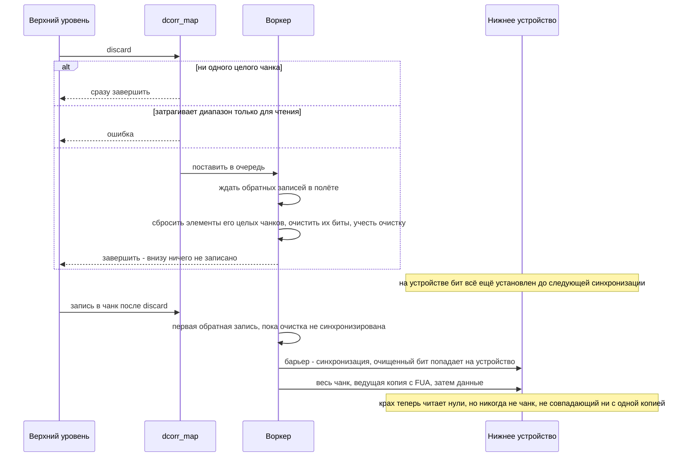

Покрыто [`test_discard.py`](../../tests/test_discard.py) (целиком); [`test_crash.py`](../../tests/test_crash.py):
`test_a_discard_cut_anywhere_reads_old_or_zeros`, `test_a_write_after_a_discard_cut_anywhere_reads_zeros_or_new`;
[`test_bitmap.py`](../../tests/test_bitmap.py): `test_a_discard_touching_a_read_only_block_fails_whole`.

## Write zeroes

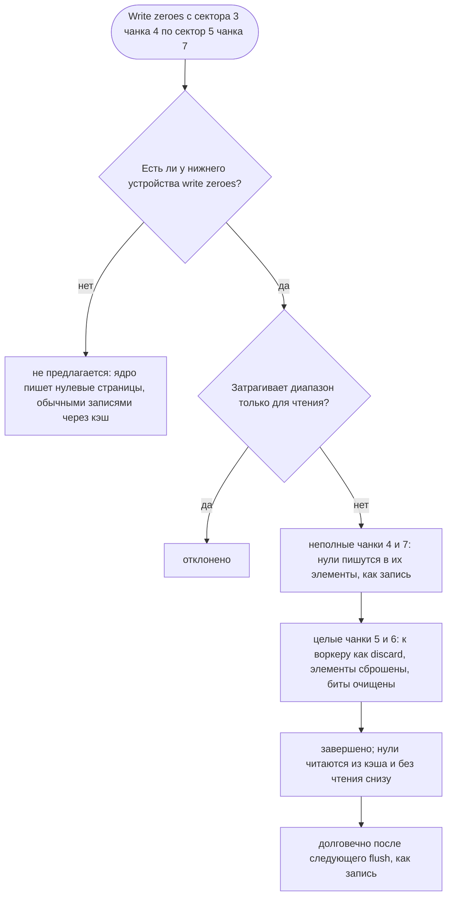

Покрыто [`test_discard.py`](../../tests/test_discard.py): `test_the_device_offers_discard_in_chunks_and_write_zeroes`,
`test_write_zeroes_reads_zeros_and_keeps_the_neighbours`, `test_write_zeroes_survives_recreating_the_device`,
`test_write_zeroes_over_data_in_the_cache`, `test_blkdiscard_z_zeroes_through_write_zeroes`,
`test_write_zeroes_inside_one_chunk_zeroes_only_its_sectors`; [`test_lower_errors.py`](../../tests/test_lower_errors.py):
`test_write_zeroes_is_not_offered_over_a_lower_device_without_it`.

## Сбои нижнего устройства

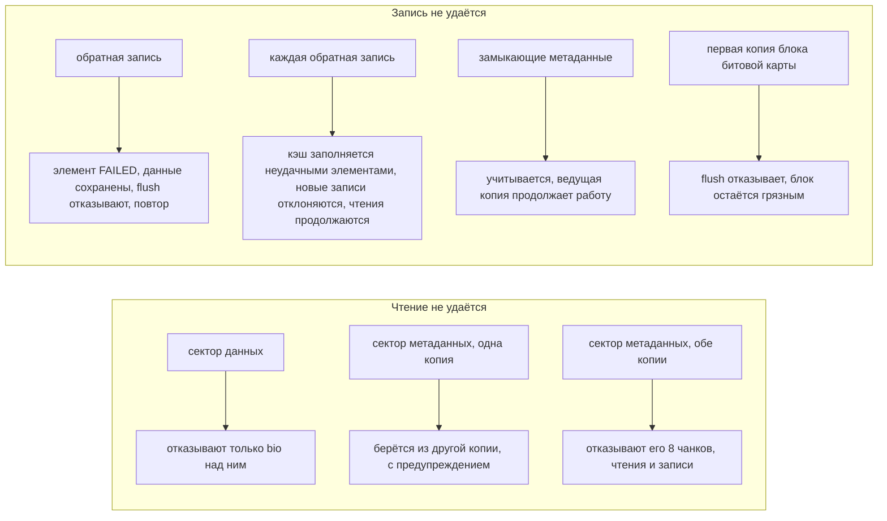

Покрыто [`test_lower_errors.py`](../../tests/test_lower_errors.py) (целиком);
[`test_bitmap.py`](../../tests/test_bitmap.py): `test_a_flush_fails_when_the_first_copy_of_a_block_fails_to_write`,
`test_a_second_copy_that_fails_to_write_is_counted`. Сектор метаданных, не читающийся в одной копии после краха:
[Сектор метаданных, восстановленный из одной копии](#сектор-метаданных-восстановленный-из-одной-копии);
неудавшийся flush: [Неудавшийся flush нижнего устройства](#неудавшийся-flush-нижнего-устройства).

## Каждая ошибка — сигнал

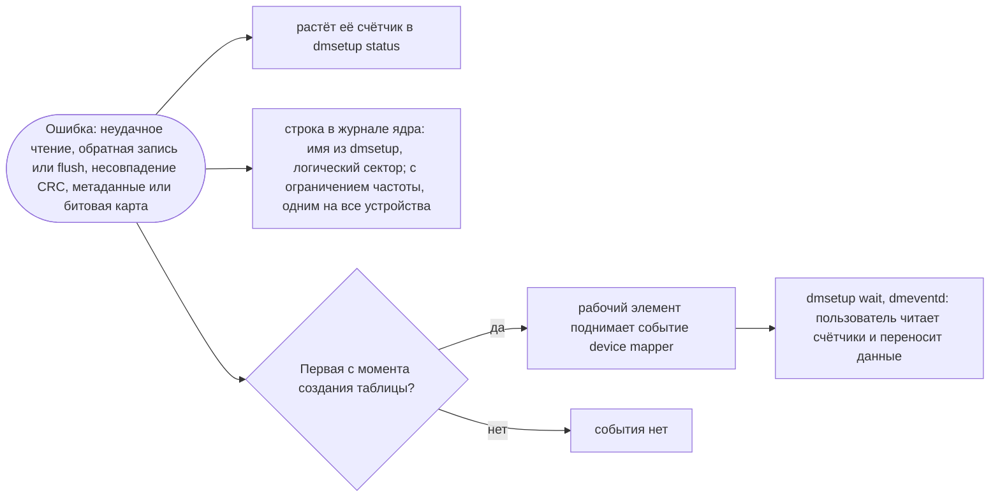

Покрыто [`test_lower_errors.py`](../../tests/test_lower_errors.py):
`test_the_first_error_raises_one_device_mapper_event`, `test_a_failed_read_is_counted_and_logged_with_the_device`,
`test_a_failed_metadata_read_is_counted_in_sectors`, `test_a_failed_flush_is_counted`,
`test_failed_write_is_reported`; [`test_corruption.py`](../../tests/test_corruption.py):
`test_every_damaged_sector_of_a_read_is_counted_and_logged`,
`test_a_flood_of_mismatches_is_counted_whole_and_logged_rate_limited`. Ограничение каждого места кода общее для
всех устройств, так что поток на одном скрывает первые ошибки другого на 5 с: строгий `xfail`
`test_a_flood_on_one_device_does_not_hide_the_errors_of_another`.

## Потерянные записи

Запись, подтверждённая нижним устройством, но так и не попавшая на его носитель.

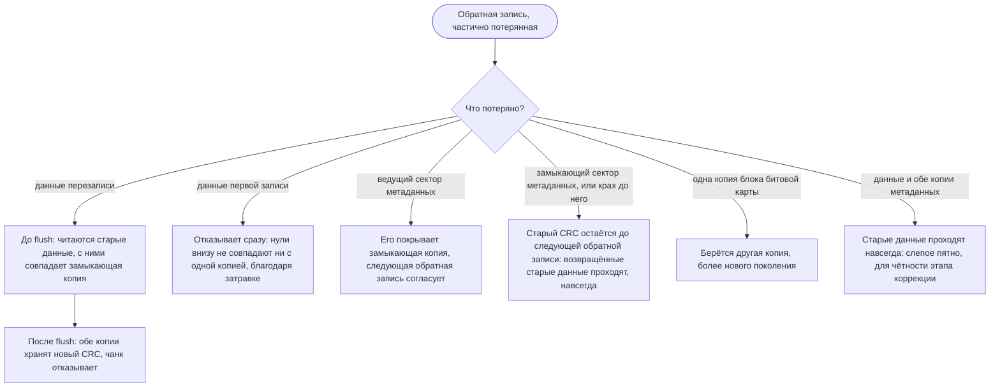

Покрыто [`test_lost_writes.py`](../../tests/test_lost_writes.py) (целиком); затравка —
[`test_corruption.py`](../../tests/test_corruption.py): `test_zeroed_chunk_is_detected`,
`test_chunk_copied_elsewhere_is_detected`, `test_sectors_swapped_inside_a_chunk_with_their_crcs_are_detected`,
`test_a_zeroed_region_with_its_chunks_written_is_detected`, `test_a_region_shifted_whole_with_its_metadata_is_detected`,
`test_a_chunk_from_another_device_is_detected`. Потерянный замыкающий сектор нарисован в разделе [Замыкающая копия
после перезапуска](#замыкающая-копия-после-перезапуска).

## Случаи, которые сейчас не проходят

Найдены при просмотре `src/` 2026-11-17, каждый закреплён строгим `xfail` с пунктом в [TODO.md](TODO.md);
диаграмма показывает путь к неверному результату. Позитивный контроль каждого теста проходит.

### Более старая копия блока битовой карты

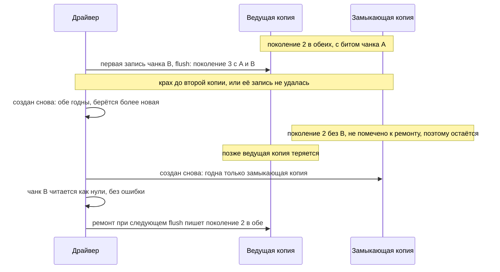

Закреплено `test_an_older_copy_is_rewritten_before_the_newer_is_lost`: с одним flush между ними — строгий `xfail`;
с первой записью в другой чанк блока между ними, которая переписывает обе копии, тест проходит.

### Обнулённый чанк в диапазоне только для чтения

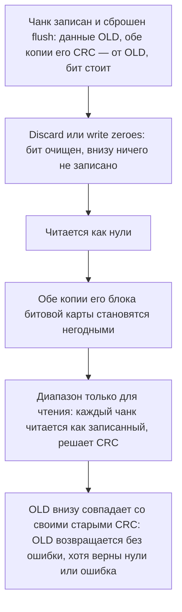

Закреплено `test_a_zeroed_chunk_in_a_read_only_block_never_reads_its_old_data`, для discard и write zeroes.

### Сектор метаданных, восстановленный из одной копии

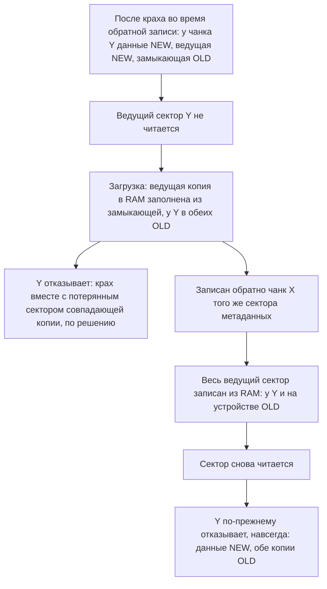

Зеркальный случай: крах до данных оставляет данные OLD, ведущую NEW, замыкающую OLD; замыкающий сектор не
читается, заполняется NEW, и следующая синхронизация пишет NEW поверх него. Закреплено
`test_a_sector_rebuilt_from_one_copy_keeps_its_neighbours_readable`, оба случая — строгий `xfail`; с равными
копиями, позитивный контроль, Y читается.

### Замыкающая копия после перезапуска

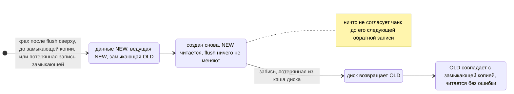

Закреплено `test_old_data_put_back_fails_once_the_new_was_read`: с потерянной замыкающей копией — строгий
`xfail`; с обеими записанными копиями возвращённые старые данные не проходят CRC.

### Поиск берёт копию, сохранённую как данные

```mermaid
flowchart TD
    fmt["Форматировано с группами по 32 MiB: группа 1 начинается с 32 MiB"] --> img["Образ суперблока группы 1 для групп по 16 MiB сохранён как данные, на 16 MiB, внутри группы 0"]
    img --> dmg["Группа 0 повреждена"]
    dmg --> p16["Поиск сначала пробует 16 MiB: образ годен для этого места"]
    p16 --> wrong["Взята разметка 16 MiB"]
    wrong --> refused["Длина таблицы не равна её ёмкости: отказ"]
    p16 -. "не читается" .-> truecopy["Настоящая копия на 32 MiB"]
```

Закреплено `test_a_superblock_stored_as_data_does_not_win_the_probe`. С таблицей под разметку образа устройство
поднялось бы на неверной разметке.

### Два устройства на одном нижнем

```mermaid
flowchart LR
    a["Устройство A: свои кэш, метаданные и битовая карта в RAM"] -- "первая запись чанка C, flush: бит поставлен" --> low[("Одно нижнее устройство")]
    b["Устройство B: битовая карта прочитана при его resume, раньше"] -- "чтение C" --> zeros["в RAM нет бита C: нули, без чтения вниз и без ошибки"]
    a -. "каждое пишет свою битовую карту поверх чужой" .- b
```

Закреплено `test_a_second_device_on_the_same_lower_device_is_refused_or_agrees`: device mapper принимает вторую
таблицу, так что второе устройство читает нули там, где первое записало.
