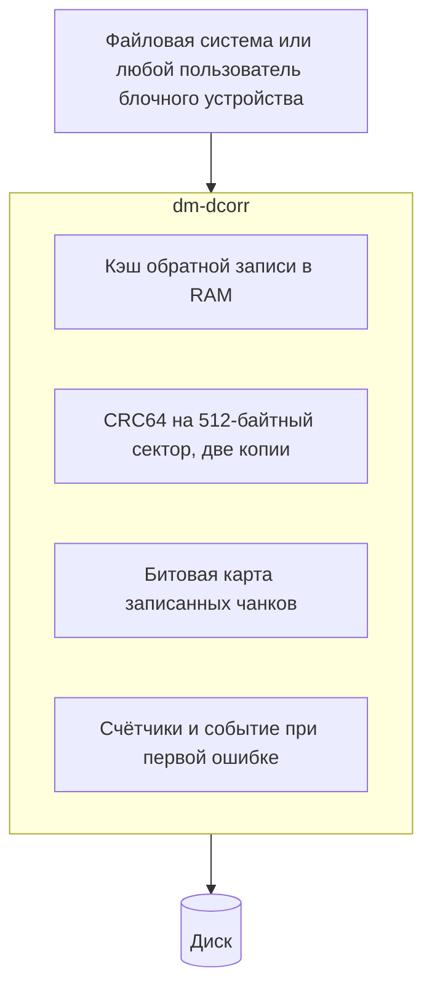
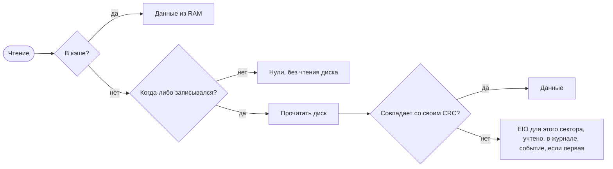

# dm-dcorr

[English version](../../README.md)

**Target device mapper для Linux, который сохраняет данные отказывающего диска читаемыми достаточно долго, чтобы
их перенести.** Он сверяет каждый прочитанный сектор с собственным CRC64, превращает повреждённые данные в ошибку
чтения вместо неверных данных и поднимает тревогу при первом признаке беды. Исправление повреждённых данных кодом,
исправляющим ошибки, — следующий большой шаг: место для его чётности уже есть в формате на диске.

> **Состояние: в разработке.** Обнаружение работает и глубоко протестировано; коррекция и работа над
> производительностью впереди, см. [этапы](#состояние). Пока не доверяйте ему данные, у которых нет другой копии.

## Зачем

Диски редко умирают сразу. Секторы перестают читаться, биты тихо портятся, записи теряются при отключении питания,
а после первой ошибки диск в 14–39 раз вероятнее откажет в ближайшие два месяца
([прочитанное, на чём это основано](RESEARCH.md#отказы-дисков)). Файловая система доверяет тому, что вернул диск,
так что тихая порча расходится и по резервным копиям. dm-dcorr стоит между файловой системой и диском и делает
порчу видимой в тот момент, когда её читают.



## Что он даёт сегодня

- **Тихая порча ловится.** Каждый прочитанный сектор сверяется со своим CRC; сектор, который не совпал, отказывает
  с `EIO`, и только он. CRC включает соль устройства и место сектора, так что ловятся и данные, записанные не на
  своё место, взятые с другого устройства или прочитанные как нули.
  [Модель угроз](ARCHITECTURE.md#модель-угроз)
- **Крах оставляет старые или новые данные, но никогда не ложную ошибку.** CRC хранятся в двух копиях, которые
  пишутся в порядке, переживающем оборванную запись, так что драйвер никогда не принимает прерванную запись за
  порчу. [Контракт](ARCHITECTURE.md#контракт-с-верхним-уровнем)
- **Потерянные записи ловятся.** Запись, которую диск подтвердил и отбросил, не проходит свой CRC, как только прошёл
  следующий flush. [Диаграмма](DIAGRAMS.md#потерянные-записи)
- **Отказывающий диск продолжает работать, где может.** Сектор, который не читается, делает неудачными только
  запросы над ним; неудачная запись остаётся в RAM и повторяется, а flush отказывают, пока она не записана.
  [Ошибки](ARCHITECTURE.md#ошибки)
- **Каждая ошибка — сигнал.** `dmsetup status` считает неудачные чтения, записи и flush и повреждённые секторы,
  первая ошибка поднимает событие device mapper для `dmsetup wait` или `dmeventd`, а журнал ядра называет
  устройство и сектор. [Интерфейс](ARCHITECTURE.md#интерфейс)
- **Обычное блочное устройство.** Файловые системы работают на нём без изменений: flush и записи FUA соблюдаются,
  discard и write zeroes работают чанками по 4 KiB, а данными при группах по 1 GiB занято около 91% диска;
  остальное — метаданные, около 3%, и место, зарезервированное под чётность, 6,25%.
  [Формат на диске](ARCHITECTURE.md#формат-на-диске)

Что происходит при чтении:



Другие ситуации, каждая с покрывающими её тестами, — в [DIAGRAMS.md](DIAGRAMS.md).

## Быстрый старт

Он собирается и тестируется с Linux 7.1 и 7.2. Нужны заголовки вашего ядра, `make` и компилятор C.

```bash
make                                   # dm-dcorr.ko and tools/dcorrsetup
sudo modprobe dm-mod
sudo insmod dm-dcorr.ko
```

Отформатируйте устройство и поставьте на него драйвер. **Форматирование перезаписывает заголовки устройства**, так
что берите устройство, данные которого вам не нужны:

```bash
sudo tools/dcorrsetup format /dev/sdX
sudo tools/dcorrsetup table /dev/sdX | sudo dmsetup create dcorr
sudo mkfs.ext4 /dev/mapper/dcorr
```

`dcorrsetup format` отказывает устройству, которое используется или уже хранит годный суперблок, если не задан
`--force`; `--group-size` выбирает размер группы, по умолчанию `1G`. Устройство не обязательно обнулять: никогда не
записанные чанки читаются как нули. У нижнего устройства должны быть логические блоки по 512 байт.

Наблюдение:

```bash
sudo dmsetup status dcorr              # 26 counters, see Interface
sudo dmsetup wait dcorr                # returns once an event is raised, as at the first error
sudo dmsetup remove dcorr
```

## Состояние

| Этап | Что | Состояние |
| --- | --- | --- |
| Тестовая база | 368 тестов в VM: данные, порча, крахи, воспроизводимые из журнала, отказывающие диски, файловые системы, нагрузка | Сделано; коммит перед кэшем ещё надо пометить для базовых замеров |
| Кэш | Собственный кэш обратной записи, flush и FUA | Сделано |
| Целостность и формат | Группы и суперблоки, две копии CRC, битовая карта записанных чанков, discard | Сделано |
| Интеграция с device mapper | Счётчики, событие, таблица, ограничения очереди, write zeroes; эта документация | Сделано |
| Серии | Соседние чанки записываются обратно одним запросом | Следующий |
| Базовые замеры | Бенчмарки на ядре без отладки | Запланировано |
| Коррекция | Стирающий код между чанками, восстановление повреждённых данных | Запланировано |
| Оптимизация | То, что оставлено простым ради корректности | Запланировано |

Производительность этой версии ещё не измерялась; цифры первой версии, в которой не было кэша, — в
[её документации](archive/full_docs.pdf). Подробности каждого этапа — в [TODO.md](TODO.md#этапы).

## Документация

| Документ | Что в нём |
| --- | --- |
| [ARCHITECTURE.md](ARCHITECTURE.md) | Как он работает: глоссарий, модель угроз, контракт, формат, путь ввода-вывода, интерфейс |
| [DIAGRAMS.md](DIAGRAMS.md) | Его ситуации в картинках, с тестами, которые их покрывают |
| [DECISIONS.md](DECISIONS.md) | Почему он построен так: каждый выбор, варианты, причины |
| [RESEARCH.md](RESEARCH.md) | Прочитанное, на чём он основан: как отказывают диски, как это делают другие target |
| [TESTS.md](TESTS.md) | Что проверяют тесты и как показано, что они ловят ошибки |
| [DEPLOY.md](DEPLOY.md) | VM для разработки, где драйвер собирается, загружается и тестируется |
| [TODO.md](TODO.md) | Что ещё не сделано, и этапы |
| [TODO_OPTIMIZATION.md](TODO_OPTIMIZATION.md) | Что оставлено простым, чтобы измерить и улучшить |

## Разработка

Драйвер собирается, загружается и тестируется только в VM на QEMU с отладочным ядром (KASAN, lockdep, kmemleak),
никогда на хосте разработчика: `deploy/vm.sh test` запускает там тесты, `deploy/vm.sh check` — предупреждения
компилятора, sparse и checkpatch. Крахи воспроизводятся из журнала записей, отказывающие диски делаются через
`dm-dust` и `dm-flakey`, а для каждого нового теста показано, что он падает на намеренно сломанном драйвере. См.
[DEPLOY.md](DEPLOY.md) и [TESTS.md](TESTS.md).

## Лицензия

GPL-2.0. Автор: Alexey Smirnov. Разработан в рамках исследования целостности данных на блочном уровне для
подсистемы хранения Linux.
